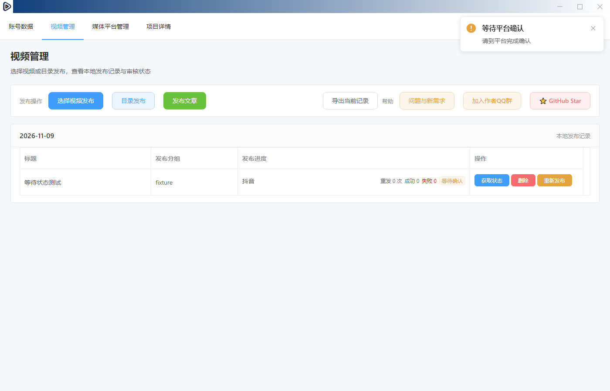

# 等待平台确认的原任务语义

## 本次修复范围

修复原未提交回归测试暴露的链路缺口：收到平台扫码/安全确认进度后仍显示发布中；定时任务把等待或草稿当作发表成功；历史查询用旧成功计数覆盖等待状态；CSV 不认识等待确认。沿用 `needs_attention` / 退出码 4，增加其原始 `waiting_confirmation` 原因，不增加平台上传器或公众号发布能力。

- `puppeteerFile-progress` 的 `waiting_confirmation` 只更新原记录，成功/失败计数不增长，CLI 继续等待；`verifying` 继续核验。
- 最终仍需确认时保留 `outcome: waiting_confirmation`、原发表/草稿意图和消息，退出 4，不触发重试。无消息时也不能显示上传成功。
- 即时、定时、目录批量和 GUI 共用结果/进度转换。主进程按 taskId 隔离任务，终结后忽略重复或迟到回执。
- GUI/任务登记持久绑定 `taskId`；`publishSettled` 区分暂时等待和最终待确认。GUI 通过 `expectedTaskId` 在同一主进程的同步存储边界比较当前代次和终结标记后写入，旧任务、迟到/重复回执返回 `stale_publish_task`，不覆盖新任务或终态。旧历史仍可只读；重新发布时建立新代次。
- GUI 视频管理、`cli history` 的中英文筛选、CSV 和 MCP 历史枚举均识别等待确认。MCP 不再把所有退出码 4 强制解释为草稿保存。

## 实际验证

基线为 `284e47a`，Node 20.15.1 / Yarn 1.22.22。原等待进度、历史、CSV 测试均先失败，逐项最小实现后通过。新增 CLI 测试通过真实临时 JSON 存储及对外 `runCliMain` 验证即时/目录模式：目录入口曾错误退出 0，修复后退出 4、成功数 0，重复终结回执不覆盖原等待记录。仅 Electron 和发布浏览器边界受控替代，没有替换存储或结果策略。

MCP 在锁定 SDK 1.29.0 的依赖下完成构建，新增回归先确认等待被错报为 draft，再确认修复后保留 publish / waiting_confirmation；与受影响后台任务测试共 5 项通过。首次构建因缺依赖失败；锁定镜像不可达后，仅临时替换下载源到 npm 官方注册表安装同一锁定版本，安装结束恢复锁文件，未提交依赖变更。

真实 Electron / Vue / HTTP 数据服务的 GUI 测试隔离 HOME、userData 和 Documents，只使用合成记录。实际收到进度却显示发布中的红灯已复现；修复后可从应用菜单查看等待确认，公开数据接口返回记录数 1、成功 0、失败 0。截图已实际查看：


适用命令（均由根包脚本、MCP 构建脚本和开发说明发现）：

```bash
node scripts/test-publish-waiting-confirmation.js
node scripts/test-publish-waiting-confirmation-cli.js
xvfb-run -a node scripts/test-publish-waiting-confirmation-gui.js
yarn test:publish-abnormal
yarn test:history-status
yarn test:history-args
yarn test:publish-history-csv
yarn test:scheduled-dedupe
yarn test:publish-draft-args
yarn test:article-republish
yarn test:pushdata-dedupe
yarn test:change-data-path
yarn --cwd mcp build
node --test mcp/tests/publishWaitingConfirmation.test.mjs mcp/tests/publishJobs.test.mjs
yarn build:dir
git diff --check
```

上述构建和受影响测试已通过。GUI 测试前必须先完成根包构建，不能在运行时并行重建 dist。测试启动器曾有 Electron 加载/菜单定位错误，已修正后才计入有效红绿证据；不把测试环境错误计为产品红灯。

## 早期验证限制与回退

2026-11-06 的 Linux 验证曾因缺少 ffmpeg、账号参数和登录态而未完成真实上传：`e2e/artifacts/20261106-024001/report.md` 分类 ERROR，CLI 退出 2，`draftVerified=N/A`。这是早期受限记录；2026-11-09 已补齐 Windows 抖音显示窗口模式的真实草稿通过证据及 Windows GUI 验证，详见下节。根包未配置类型/lint（N/A），MCP 类型检查由构建覆盖；完整仓库门禁和已安装打包产物仍未验证。

## 审查修复

Standards 与 Spec 均发现草稿等待回执丢失原意图，以及 GUI 缺少任务关联/终结写入保护；Standards 另指出目录草稿计数与其他入口分叉。均以对外 CLI 或真实 Electron/HTTP 旅程重现后修复：草稿等待原先返回 publish，现保留 draft；其他任务的等待事件原先改变当前记录，现忽略；终结后的迟到进度/重复回执被拒绝，并验证 HTTP 交错终结/进度写入；目录草稿成功计数原先 0，现为 1。复审及干净 PR 分支验证在固定修复提交后继续运行，不将进行中的验证算通过。

复审发现主进程回写也需携带代次条件。新增真实 CLI/存储交错回归：同素材 A 尚未结束即登记 B，A 进度原先把 B 改成等待确认；修复后 A 的进度/完成写入均返回 `stale_publish_task`，保留 A 自己的实际回执、不误触发重发，B 继续独立终结。即时、目录与定时主进程均传入捕获的当前代次；定时任务在开始条件写入失败时不执行发布。测试移除原稿对内部存储/账号策略的替代，通过真实临时 JSON 和公开 history 核对即时/定时行为。

受影响兼容检查发现旧草稿结果精确断言未包含新增的两个布尔标记，现补全明确的 false/true 预期，保留草稿和退出码断言。文章重发测试在 Node 20 下缺少 CommonJS 转换而无法加载原有 ESM 工具，按现有测试规范显式配置 preset-env 后通过；不改变文章重发产品逻辑。

没有 schema 迁移、账号清理或发布重试策略变更；没有新增独立状态机，现有共享回执模块是唯一状态转换边界，无新增 ADR 系列。回退保留历史 `waiting_confirmation` 及原消息，禁止把这些记录当成功或自动重新发布；应停受影响任务并到平台核对原内容。当前原稿中的公众号配置/登录能力未随此修复交付。

## 最终受影响验证与复审

在独立 PR 分支的固定代码提交 `301b99f` 完成上述根包受影响测试、真实 Electron GUI 测试及 `yarn build:dir`，均退出 0。MCP 源码在最终代次修复中未变，已完成构建及上述 5 项测试（0 失败、0 跳过）。依赖通过本地链接复用且仅由本地 Git exclude 忽略，不提交依赖或构建产物；此分支只包含本切片的代码、测试和文档。

固定非空范围 `284e47a...301b99f` 的 Standards / Spec 独立复审均无新增可操作问题，前述发现均已修复。权限/路径范围、同素材并发任务、重复及迟到回执、错误码和存储一致性由受影响回归覆盖。当时因缺少真实平台证据保持 Draft；后续补验结果及当前范围如下。

## Windows 补验（2026-11-09）

环境为 Windows 10 x64（19045）、Node 20.20.2、Yarn 1.22.22、Electron 24.8.8，目录 `D:\MatrixMedia`。发布业务代码版本为 `d6681d2186f10a27de96f5de962625cfc789f040`；本次仅修改 GUI 测试启动与导航、验收文档及合成数据截图，没有修改发布器、回执或 e2e 分类逻辑。Windows 系统默认 Node 为 26，本次命令均显式使用上述 Node 20 或将其目录前置到当前会话 PATH。

### GUI 启动与菜单问题

原命令可复现两层环境故障：

1. 测试启动器把 `ELECTRON_RUN_AS_NODE` 设为空字符串，该 Windows 环境仍以 Node 模式启动 Electron，临时 `probe.cjs` 报 `Cannot find module 'electron'`。现改为从子进程环境中删除该变量；最终通过测试时，父进程特意设置为 `1`，验证继承值也能被隔离。
2. 去掉该变量后，路由初始化报 `TypeError: i.hasInjectionContext is not a function`。本机 `vue-demi` 错用 Vue 3 适配层（`isVue2=false`），而安装的 Vue 为 2.7.16。执行依赖自带的 `node node_modules/vue-demi/scripts/postinstall.js` 后，确认 `isVue2=true`、`hasInjectionContext` 为函数，再重新构建。没有修改依赖版本、锁文件或手工编辑 dist 文件。

菜单恢复后，更新提示遮罩及其关闭动画仍会吞掉导航点击。GUI 测试现通过真实“暂不更新”按钮关闭提示，并用 `elementFromPoint` 确认菜单可接收点击后进入视频管理；没有替换路由、存储或发布状态处理。

在 Node 20 / Yarn 1.22.22 下执行：

```powershell
node node_modules/vue-demi/scripts/postinstall.js
yarn build:dir
$env:ELECTRON_RUN_AS_NODE = '1'
node scripts/test-publish-waiting-confirmation-gui.js
Remove-Item Env:ELECTRON_RUN_AS_NODE
```

构建与 GUI 测试退出 0，GUI 输出 `GUI waiting_confirmation / zero success / one record: passed`。实际结果为 `{"status":"waiting_confirmation","successCount":0,"failCount":0,"records":1,"concurrentTerminalProtected":true}`。截图已实际查看，仅包含合成记录；测试结束后没有残留本仓库 Electron 进程。



另以 Node 20 重跑 11 个脚本，均退出 0：`test-publish-waiting-confirmation`、`test-publish-waiting-confirmation-cli`、`test-publish-abnormal`、`test-history-status`、`test-history-args`、`test-publish-history-csv`、`test-scheduled-dedupe`、`test-publish-draft-args`、`test-article-republish`、`test-pushdata-dedupe`、`test-change-data-path`（均位于 `scripts/`，后缀 `.js`）。本次未修改 MCP；前次 Windows MCP 构建通过，相关测试 5/5 在仅将 POSIX shebang 合成夹具改由 Node 启动的临时启动器下通过，原生夹具运行曾有 4 项失败，此限制仍保留。

### 真实平台草稿证据

已重新读取 Windows 本机原始报告 `D:\MatrixMedia\e2e\artifacts\20261109-075617\report.md` / `report.json`，并与既有 PR 记录核对。该轮使用本机扫码登录态与合成视频，命令为：

```powershell
node --require D:\DevTools\Apps\MatrixMediaRuntime\electron-direct-launch.cjs e2e/run.js -p dy --yes --phone <本机测试分组> --video e2e/artifacts/fixtures/windows-test-video.mp4 --skip-build --show --timeout 180
```

临时启动器只给 Electron 子进程添加 `--no-proxy-server --disable-gpu` 并移除空 `ELECTRON_RUN_AS_NODE`；系统代理配置未修改。结果为 `PASS_VERIFIED`，runner 与 CLI 退出 0，`resultStatus=draft`、`publishMode=draft`、`draftVerified=true`、`draftUrlUnchanged=false`。报告诊断行：

```text
[dy] 已点击存草稿按钮 (#popover-tip-container+button)
[publish] 抖音 存草稿后页面地址已变化（草稿模式仅记录，不判定异常）：https://creator.douyin.com/creator-micro/content/upload?enter_from=publish
[publish] 抖音 已确认草稿保存成功（页面已跳转：https://creator.douyin.com/creator-micro/content/upload?enter_from=publish）
```

`--yes` 未进行后台人工核对；通过依据为平台保存后的跳转与回执字段。回执 message 仍沿用“网页端无草稿箱，无法核验”的旧文案，本次没有改写。早一轮隐藏窗口 run `20261109-073818` 为 `NEEDS_ATTENTION`、CLI 退出 4、`outcome=draft_unverified`、`draftUrlUnchanged=true`，该失败记录仍保留，隐藏模式尚未确认。账号、Cookie、原始平台截图与素材均留在 Windows 本机，没有提交。

Windows GUI 和显示窗口模式的真实草稿证据已补齐，可将 PR 转为可审查状态。审查范围仍需保留隐藏模式、已安装打包产物和完整仓库门禁的上述限制。真实平台测试产生的 `MM-E2E` 草稿请在核对后清理。
